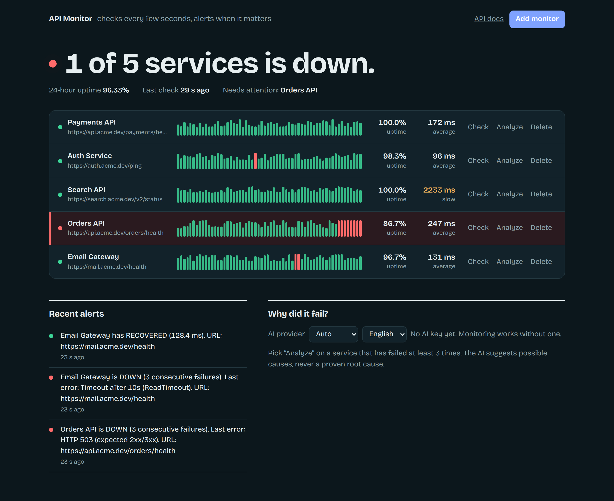
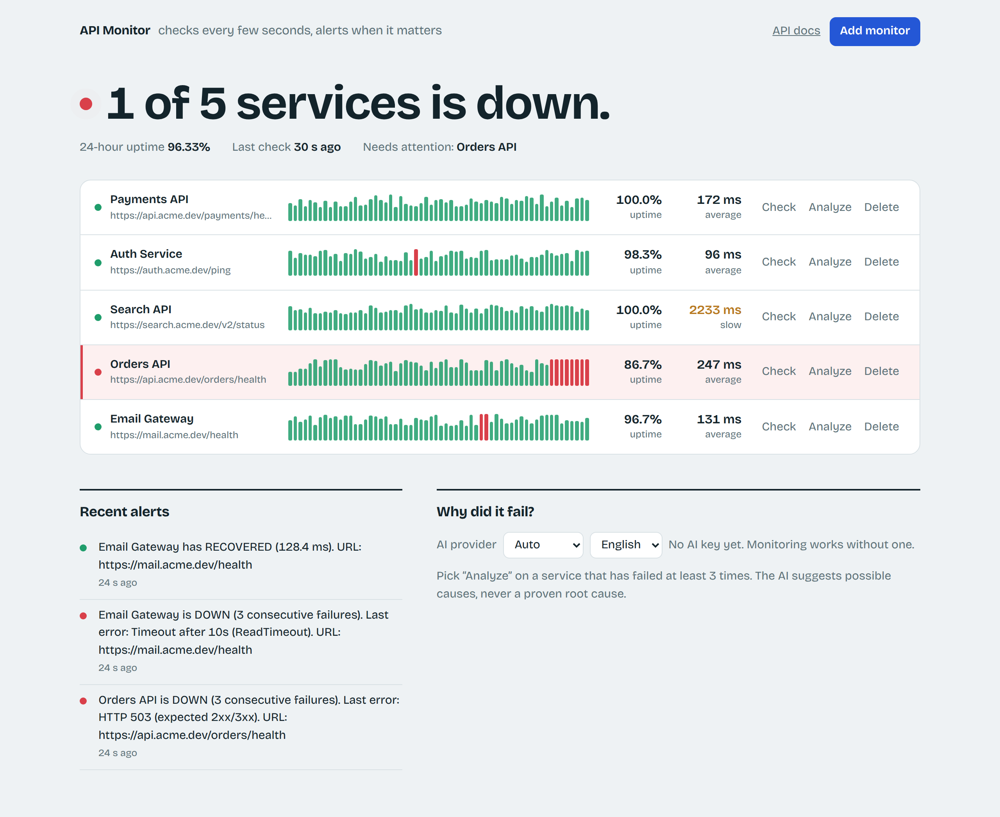
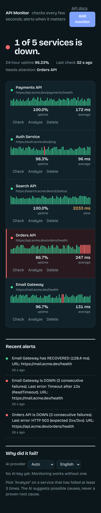

# python-api-monitoring-system

**Python API Monitoring & Alert System** - a self-hosted service that checks your APIs on a schedule, records response times, logs errors, alerts you when something fails, and reports uptime. Optional AI failure analysis works with **Claude, ChatGPT or Gemini** (any one API key).

**Stack:** Python 3.12 · FastAPI · httpx (async) · SQLite · pytest · Docker

## Screenshots

### Dashboard (dark mode)


Each service shows a *pulse strip* of its last 60 checks: bar height is response time, red bars are failed checks.

<table>
<tr>
<td align="center"><b>Light mode</b><br></td>
<td align="center"><b>Mobile</b><br></td>
</tr>
</table>

> Screenshots use sample data for illustration.

## Features

| Area | What it does |
|---|---|
| Scheduled checks | Per-monitor interval, timeout, HTTP method and expected status code |
| Response time | Measured per check; avg / min / p95 / max in reports |
| Error logging | HTTP errors, timeouts, DNS/connection errors stored with the reason |
| Alerts | `DOWN` after N consecutive failures, `RECOVERED` on first success; one alert per state change (no alert storms). Console + DB always; Slack/Discord/webhook and email optional |
| Uptime report | Uptime %, latency stats, error breakdown, incident list for any window up to 30 days |
| Dashboard | Live page at `/` (add monitors, check now, AI analyze) |
| AI analysis | Provider-agnostic; hypotheses with confidence levels, never presented as proven root cause |

## Quick start (local)

```bash
python -m venv .venv && source .venv/bin/activate      # Windows: .venv\Scripts\activate
pip install -r requirements.txt
cp .env.example .env                                   # Windows: copy .env.example .env
# optional: paste ONE AI key into .env (Anthropic, OpenAI or Gemini)
uvicorn app.main:app --reload
```

Open **http://localhost:8000** (dashboard) or **http://localhost:8000/docs** (interactive API docs).
With `SEED_DEMO=true` four demo monitors are created on first start, including one that always fails so you can see alerts immediately (needs internet access for httpbin.org / github.com).

## Quick start (Docker)

```bash
cp .env.example .env      # add an AI key if you want AI analysis
docker compose up --build
```

Data persists in the `monitor-data` volume. To run the tests inside the image: `docker compose run --rm monitor pytest -q`.

## AI providers

Put **any one** key in `.env`:

```
ANTHROPIC_API_KEY=...     # Claude
OPENAI_API_KEY=...        # ChatGPT / OpenAI
GEMINI_API_KEY=...        # Google Gemini (GOOGLE_API_KEY also works)
AI_PROVIDER=auto          # auto = first configured; or force anthropic | openai | gemini
```

* The dashboard has a provider dropdown; the API accepts `?provider=` per request.
* Model names are env-configurable (`ANTHROPIC_MODEL`, `OPENAI_MODEL`, `GEMINI_MODEL`) because providers rename and retire models. If a call returns a 404 "model not found" error, update the variable.
* `?language=hi` returns the analysis in Hindi.
* Check which keys are detected: `GET /ai/providers`.

### How the AI is kept honest

1. The AI is **not called** unless there are at least `AI_MIN_FAILURES` failures in the window; the API returns `insufficient_data` instead.
2. It only receives statistics computed from stored checks (status codes, latency, error strings, timing patterns) - not raw guesses.
3. The system prompt forbids stating a root cause as fact; every cause must carry a confidence level, the supporting evidence, and what extra data would be needed to confirm it. "High" confidence is reserved for evidence that is explicit in the data.
4. Every response includes a disclaimer and the exact `evidence` object that was sent, so results are auditable.

## API overview

| Method | Path | Purpose |
|---|---|---|
| POST/GET | `/monitors` | Create / list monitors |
| GET/DELETE | `/monitors/{id}` | Read / delete |
| POST | `/monitors/{id}/pause` · `/resume` | Pause or resume checking |
| POST | `/monitors/{id}/check` | Run a check immediately |
| GET | `/monitors/{id}/checks?limit=` | Raw check history |
| GET | `/alerts` | Alert history |
| GET | `/reports/uptime?hours=24` | Uptime report for all monitors |
| GET | `/reports/uptime/{id}?hours=` | Report for one monitor |
| GET | `/ai/providers` | Which AI keys are configured |
| POST | `/monitors/{id}/analyze?provider=&hours=&language=` | AI failure analysis |

Example:

```bash
curl -X POST localhost:8000/monitors -H 'content-type: application/json' \
  -d '{"name":"Payments API","url":"https://api.example.com/health","interval_seconds":30,"timeout_seconds":5}'
```

## Alert channels

* **Always:** server log + `alerts` table (visible in the dashboard and `/alerts`).
* **Webhook:** set `ALERT_WEBHOOK_URL` (Slack incoming webhook, Discord webhook, or your own endpoint; payload contains `text`, `content`, `kind`).
* **Email:** set `SMTP_HOST`, `SMTP_PORT`, `SMTP_USER`, `SMTP_PASSWORD`, `SMTP_FROM`, `ALERT_EMAIL_TO`.

## Project layout

```
app/
  main.py        FastAPI routes + lifespan (starts the scheduler)
  scheduler.py   asyncio loop, runs due monitors concurrently
  checker.py     one HTTP check -> result dict (never raises)
  service.py     records results, state machine, triggers alerts
  alerts.py      console / webhook / email delivery
  reports.py     uptime + latency + incidents
  db.py          all SQL (SQLite)
  ai/providers.py  Anthropic / OpenAI / Gemini REST adapters
  ai/analyzer.py   evidence builder + guarded prompt
  dashboard.py   single-page UI
docs/screenshots/  README images
tests/           23 tests; no network or real API keys needed
```

## Design notes

* **State-change alerting** with a consecutive-failure threshold avoids flapping and duplicate notifications.
* **Uptime is sampled**, not continuous: accuracy depends on the check interval (the report says so).
* **SQLite** keeps setup to zero; all SQL is isolated in `db.py` so PostgreSQL can be swapped in.
* Old checks are purged after `RETENTION_DAYS`.
* **Not included (by design, for a demo):** authentication on the API/dashboard. Put it behind a reverse proxy or add an API-key dependency before exposing it publicly, since users can make the server request arbitrary URLs.

## Tests

```bash
pytest -q
```
Uses `httpx.MockTransport`, so tests never touch the network or spend API credits.
